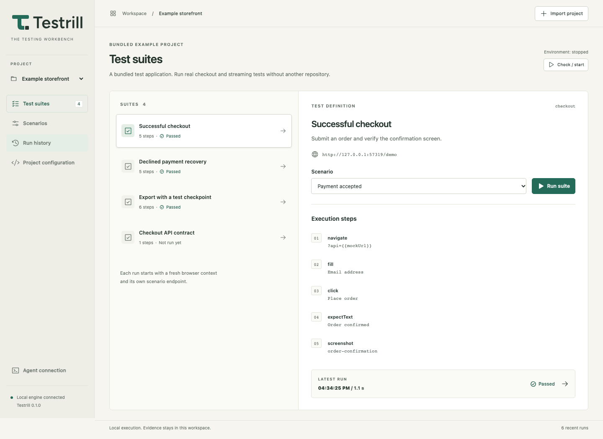

[](https://github.com/tedy69/testrill/actions/workflows/ci.yml)

A desktop testing workbench for people and agents. Prepare a local scenario, run a suite, and inspect the same evidence through the app, CLI, or MCP.

Testrill runs without a model API key. Connect the coding agent you already use. Test execution and assertion results come from the runner.



## What works

- A Tauri desktop application with a React workbench and a bundled Node engine.
- Import and validate project manifests. Edit suites, target URLs, scenarios, and environment commands.
- Inline browser tests through Playwright, HTTP assertions, existing repository commands, and a Maestro CLI adapter.
- Run-scoped HTTP mocks and SSE sequences: event IDs, delays, named checkpoints, disconnects, and resumption after a known event ID.
- Release checkpoints from inline steps, external tests, the workbench, or MCP.
- Capture screenshots, Playwright traces, network metadata, runner output, and an event ledger.
- SQLite run history, saved configuration replay, cancellation, outcome comparison, and portable ZIP exports.
- MCP over stdio or authenticated Streamable HTTP. The CLI and UI control the same engine.

Every sample suite produces real results when executed. An empty workspace contains no invented test history.

**Status:** early public preview. The installed desktop app has been exercised on macOS Apple silicon. Linux engine/UI checks and macOS compilation run in CI; Windows/Linux desktop packaging and physical mobile execution still need validation. Start from source; a notarized installer is not published here.

## Run from source

Requirements: Node.js 26 LTS or newer, npm 12.2.2, and Chromium for browser suites. Native builds also need Rust and the [Tauri platform prerequisites](https://v2.tauri.app/start/prerequisites/). See the [dependency review](docs/dependency-review.md) for versions and outstanding upstream advisories.

```sh
git clone https://github.com/tedy69/testrill.git
cd testrill
npm ci
npm run browsers:install
npm run dev
```

Open `http://127.0.0.1:1420`. The example storefront is served by the engine; no separate application is needed. Run Successful checkout, Declined payment recovery, or Export with a test checkpoint.

```sh
npm run desktop:dev
npm run desktop:build
```

The native build copies the current Node binary and the engine into Tauri resources. It does not depend on a global Node installation on the destination machine. Browser binaries are installed separately with Playwright and are not bundled. Logos, icons, social artwork, and usage guidance are in [the brand kit](brand/brand.md).

The development engine uses `.testrill/` in this repository. The native app uses the operating system's application-data directory. Agent connection shows the exact workspace and a ready-to-copy stdio configuration for that engine. Existing native workspaces are retained after the rename from the temporary name Rehearsal; see [upgrade compatibility](docs/branding-upgrade.md).

## CLI

```sh
npm run build
node dist-engine/main.cjs projects
node dist-engine/main.cjs import /absolute/path/to/project/testrill.json
node dist-engine/main.cjs run example-storefront checkout --json
node dist-engine/main.cjs run example-storefront api --json
node dist-engine/main.cjs runs --project example-storefront
node dist-engine/main.cjs inspect RUN_ID
node dist-engine/main.cjs rerun RUN_ID --json
node dist-engine/main.cjs export RUN_ID --output /absolute/path/evidence.zip
```

`run` and `rerun` wait for completion unless `--no-wait` is supplied. A completed non-passing run exits with code 1. Output is JSON. `--json` is accepted for clarity; JSON is also the default. All commands accept `--data /absolute/path/to/workspace`.

The CLI connects to the workspace engine or starts a detached one. To run an explicitly managed engine, use `node dist-engine/main.cjs serve --port 4317`. Stop it with Ctrl+C. Connection metadata is private local state and must not be committed.

## Connect an agent

Open **Agent connection** in the workbench and copy the configuration. It contains the actual engine executable, entry point, and workspace path. Use the generated stdio configuration with an MCP-capable coding client.

Tools include `list_projects`, `import_project`, `inspect_project`, `update_project`, `prepare_environment`, `stop_environment`, `run_suite`, `list_runs`, `inspect_run`, `release_checkpoint`, `cancel_run`, `rerun_saved`, `get_artifact`, and `export_run`.

Example task for your agent:

> Inspect the registered project and run its checkout suite. Poll until the run is finished. If it fails, inspect the assertion ledger and failure screenshot. Explain what failed, then rerun the saved scenario after the fix. Cite the run ID and artifact names.

The engine also exposes `/mcp` using Streamable HTTP with bearer authentication. Hosted clients such as ChatGPT cannot directly reach a loopback service. A supported connector and a separately configured authenticated bridge are necessary; Testrill does not automatically publish your local engine. See [agent integration](docs/agents.md).

## Project manifest

See [the manifest guide](docs/manifests.md), [HTTP example](examples/http/testrill.json), [existing test command example](examples/existing-tests/testrill.json), and [Maestro example](examples/mobile/testrill.json). The root directory is the manifest's directory. Paths for external commands and mobile flows are resolved there.

Importing does not execute commands. Starting an environment or running a command suite executes the command declared in that trusted manifest, with the current user's permissions. This is a local developer tool, not a sandbox for untrusted repositories.

## Outcome and evidence semantics

`queued` and `running` are not final. `passed` means all configured inline steps completed or the configured external test command exited with code 0. It does not prove unasserted behavior. `failed` means an assertion or runner failed. `blocked` indicates a missing required browser or runner. `cancelled` records cancellation; `interrupted` records an engine restart during a run.

A final outcome is persisted after artifacts finish saving. A saved rerun uses the earlier suite and scenario snapshot. Each inline browser run uses a fresh context; each selected mock scenario gets a separate endpoint. This does not reset an application's database or make its external dependencies deterministic.

ZIP exports contain a manifest, event history, captured screenshots, and traces. Traces, screenshots, command output, and saved step values may contain application data. Sensitive-looking URL query parameters are redacted from network metadata; raw browser traces and images are **not automatically sanitized**. Review before sharing.

## Verification

```sh
npm test
npm run build
npm run test:e2e
npm run docs:check
npm run format:check
npm audit
```

The integration suite executes the bundled storefront's browser flows, verifies deliberate failures and saved reruns, checks MCP and CLI behavior, scans the workbench with axe, and checks viewport overflow. See [verification evidence](docs/verification.md) for what was actually exercised locally.

## Scope

This preview establishes the shared engine, local workbench, agent interfaces, scenario control, and evidence workflow. It has a Maestro process adapter, not an embedded mobile device inspector. Command adapters can run existing desktop-app tests; arbitrary desktop interaction, database snapshot/reset plugins, collaborative workspaces, automatic test generation, and screenshot-diff baselines are not implemented. Desktop packaging and physical-device support require platform-specific validation.

## Documentation and collaboration

Start with the [documentation index](docs/README.md), [development guide](docs/development.md), [manifest reference](docs/manifests.md), or [agent integration](docs/agents.md).

Contributions are welcome. Read [CONTRIBUTING.md](CONTRIBUTING.md), then use a [bug report or feature request](https://github.com/tedy69/testrill/issues/new/choose). Ask usage and design questions in [Discussions](https://github.com/tedy69/testrill/discussions). Review the [roadmap](docs/roadmap.md) before starting a larger change.

The project has a [code of conduct](CODE_OF_CONDUCT.md), [governance guide](GOVERNANCE.md), [security reporting policy](SECURITY.md), and [changelog](CHANGELOG.md). The [agent contribution guide](AGENTS.md) and [testing skill](.agents/skills/testrill/SKILL.md) help coding agents work with the same contracts as human contributors.

[MIT license](LICENSE). Figtree is distributed under its [SIL Open Font License](public/fonts/OFL.txt).
