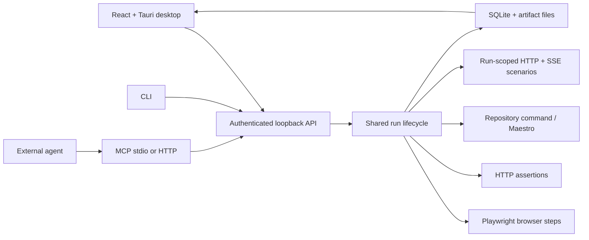

# Architecture

## Boundaries

`src/schema.ts` is the validated project contract. `src/server.ts` owns the authenticated API and workspace lifecycle. `src/runner.ts` owns run state, configured assertions, finalization, and evidence. `src/scenario-server.ts` creates a temporary loopback server for each selected scenario. `src/external-runner.ts` adapts repository commands and Maestro, forwarding the project's base URL, mock URL, checkpoint credentials, and artifact directory through environment variables.

The CLI and MCP clients do not implement separate test logic. Both use the same HTTP API as the workbench. The MCP adapter returns structured JSON and image content; long-running suites start asynchronously and are polled by run ID.

The Tauri process spawns the packaged Node runtime and reads its connection file after readiness. Its frontend receives the engine URL and token through a native command. File exports use a native save dialog. The web development server proxies API calls and injects the local token server-side.

## Persistence

SQLite runs in WAL mode. Project definitions and run manifests are persisted as validated JSON. Artifact files are stored below `artifacts/<run-id>/`. The connection file has restrictive creation permissions, and each engine holds a workspace ownership lock. Stale active runs become interrupted on restart. History lists show the most recent 100 runs; older records remain in the database. There is no automatic retention/deletion policy yet.

Configuration snapshots preserve the suite, scenario, and target URL used for a run. They do not snapshot the target's executable, database, environment, or external services. A replay is configuration replay, not full system time travel.

## Execution limits

At most three runs can execute concurrently. Runs have a five-minute overall limit. Individual waits and external commands have bounded timeouts. Event ledgers cap at 2,000 entries; browser network metadata caps at 500 entries. HTTP assertion bodies cap at 2 MB. JSON API requests cap at 2 MB. Evidence ZIP generation caps included artifact bytes at 80 MB.

Inline HTTP and navigation step URLs must use the declared target origin or that run's mock origin. HTTP assertion redirects are rejected. Browser page resources and clicks can still reach application-defined dependencies; browser execution is not a network sandbox.

## Adapter contract

The process adapter is the current extension point: a trusted manifest declares an argument array, without shell interpretation. Exit 0 means the command succeeded; nonzero means failure. Standard output and error become an evidence artifact. The command owns its test framework's assertion semantics. A Maestro adapter builds a specific invocation and retains its JUnit report when produced. Rich per-test normalization and a versioned plugin API are future work.

## Operational constraints

Loopback transport plus bearer authentication is the default. Browser origins are restricted. Import and runner operations are intended for trusted local manifests. Registered environment commands and test commands run as the local user. The app is not a multi-user service. Do not expose the raw engine publicly without a separately reviewed authentication and authorization layer.
